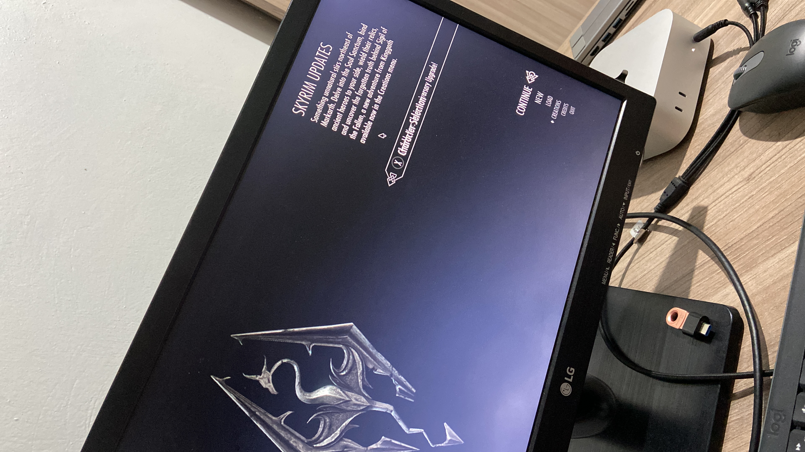
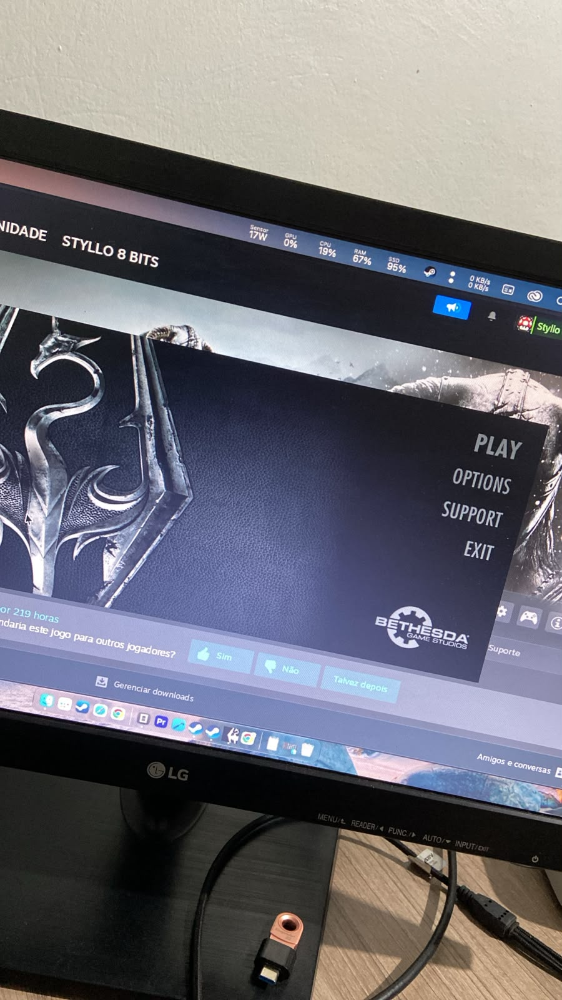
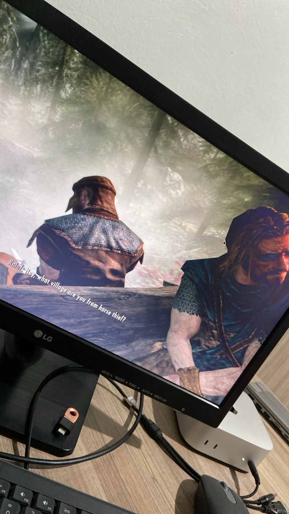
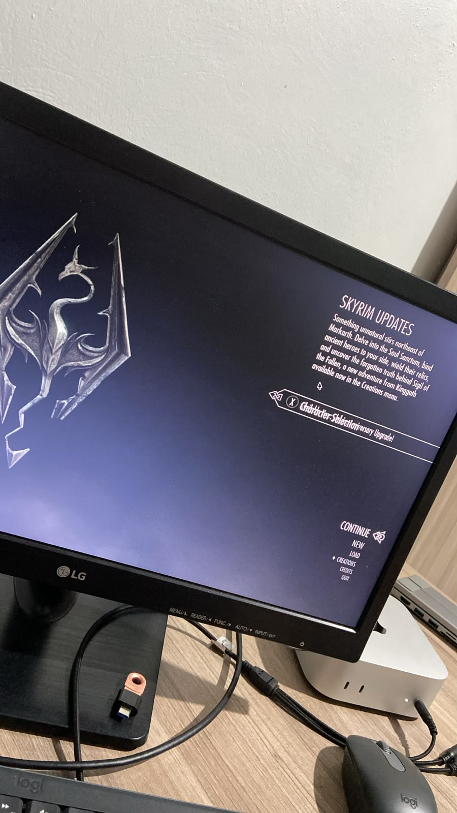
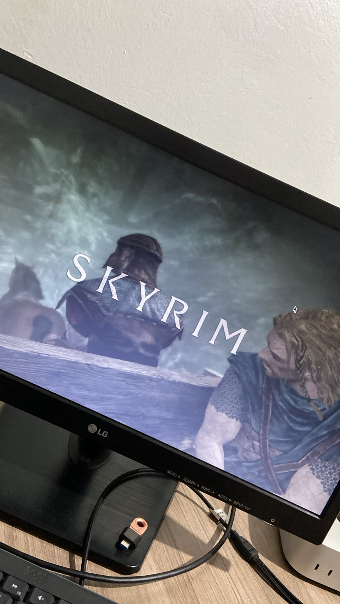
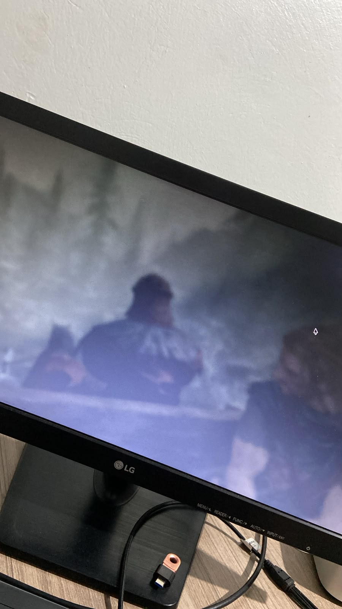

# Skyrim no Mac (Apple Silicon) 🏛️🔊

> Projeto de engenharia reversa para fazer **The Elder Scrolls V: Skyrim Special Edition** rodar em Apple Silicon (M1-M6+) usando Wine + D3DMetal — **com vozes dubladas em português**, método documentado e aberto à comunidade.

<p align="center">
  
  
</p>
<p align="center">
  <em>Skyrim Special Edition rodando em Apple Silicon com dublagem PT-BR — créditos das screenshots: CleversonBamberg</em>
</p>

## 📥 Download & Instalação Rápida

**Pacote completo (v1.0): [dist/skyrim-mac-v1.0.zip](dist/skyrim-mac-v1.0.zip)** (~3MB)

1. Baixe o pacote e extraia em qualquer pasta
2. Coloque os `.7z` da **dublagem PT-BR** ([Nexus #105861](https://www.nexusmods.com/skyrimspecialedition)) e da **tradução** ([Nexus #58406](https://www.nexusmods.com/skyrimspecialedition/mods/58406)) na mesma pasta
3. Duplo-clique em **INSTALAR.command** e siga o assistente (ele configura Steam, espera você instalar o jogo e faz todo o resto: patches, vozes, música, legendas, compressão)
4. Jogue pelo atalho **Skyrim.command** que aparece na sua Mesa 🎮

> **Requisito único**: a engine Wine+D3DMetal (o componente Apple GPTK não pode ser redistribuído — veja [Engine necessária](#engine-necessária-não-incluída--grande-demais-pra-github) abaixo). O assistente detecta a do 3Pi2 automaticamente.

## Status Atual

| Componente | Status |
|-----------|--------|
| Boot do jogo | ✅ **FUNCIONANDO** — gameplay completo |
| Gráficos (DX11→Metal) | ✅ MoltenVK + D3DMetal renderizando |
| Controles | ✅ Teclado + Controle Xbox |
| Sons ambiente/ações/menus | ✅ XAudio2 PCM direto |
| Música | ✅ via .wav PCM (conversão dos .xwm originais — WMA não decodifica no Wine) |
| **Vozes (PT-BR dublado!)** | ✅ **FUNCIONANDO** — ver [🔴 A Descoberta do Formato FUZ](#-a-descoberta-do-formato-fuz) |
| Saves | ✅ (via Steam no prefixo) |

## ⚡ Instalação com 1 comando

Com o ambiente pronto (engine Wine+D3DMetal + Steam + jogo instalados no prefixo — ver a [Receita da comunidade](#receita-da-comunidade-o-que-você-precisa) abaixo):

```bash
# só patches + vozes (inglês) + música:
./instalar-mac.sh

# completo — com dublagem PT-BR (#105861) e legendas (#58406):
PTBR="/caminho/da/dublagem-ou-.7z" TRAD="/caminho/da/traducao-ou-.7z" ./instalar-mac.sh
```

O script é **idempotente** (pode rodar de novo sem duplicar nada) e faz tudo:
patches binários → conversão de TODAS as vozes (xWMA→PCM stereo 22050Hz — sem isso
as vozes ficam mudas no Wine, que não tem decoder WMA) → 269 músicas (.xwm→.wav) →
strings da tradução → compressão APFS transparente (~50-99% de economia no disco).

## 🎙️ Vozes: dubladas ou originais — você escolhe!

| Opção | Como ativar | O que acontece |
|-------|-------------|---------------|
| **Dublagem PT-BR** | Coloque o .7z da dublagem ([Nexus #105861](https://www.nexusmods.com/skyrimspecialedition)) na pasta e responda **S** no assistente | 67 mil falas dubladas (44.1kHz stereo) + as não-dubladas em inglês |
| **Originais (inglês)** | Sem a dublagem na pasta — ou responda **n** no assistente | Todas as 75.408 falas originais em 44.1kHz mono nativo (idêntico ao Windows) |

Legendas PT-BR independem da escolha (a tradução #58406 é dos textos originais).

**Trocar depois de instalado:**
- original → dublada: `PTBR="/caminho/da/dublagem.7z" ./instalar-mac.sh`
- dublada → original: `python3 tools/voz_nativa_lotes.py` (reconverte tudo em inglês nativo)

### Opções
| Variável | Default | O que faz |
|----------|---------|-----------|
| `PTBR` | – | dublagem PT-BR (pasta extraída ou .7z do Nexus #105861) |
| `TRAD` | – | tradução de textos (pasta ou .7z do Nexus #58406) |
| `GAME_DIR` | auto-detecção | caminho do jogo, se necessário |
| `COMPACTAR` | `1` | `0` pula a compressão APFS |

## Paredes derrubadas (crônica)

| # | Parede | Solução |
|---|--------|---------|
| 1 | Steam handshake | `steam_api64.dll` patch (RestartAppIfNecessary→FALSE) + `SteamAppId=489830` |
| 2 | Gráficos DX11 | Wine Sikarugir 10.0 + D3DMetal v2.1 (Apple) |
| 3 | Crash de áudio | **4 patches binários no SkyrimSE.exe** (JE→JMP — pula calls em pointer inválido) |
| 4 | **Vozes mudas (WMA)** | **Descoberta do layout real do FUZ + conversão xWMA→PCM** (`tools/fuz_xwma_to_pcm.py`) |

## 🔴 A Descoberta do Formato FUZ

Depois de 42 experimentos tentando decodificar "XMA cru" dos arquivos `.fuz`,
descobrimos que **o parser do formato estava errado o tempo todo**. O layout real
(validado em 8000/8000 arquivos do mod PT-BR e 20/20 no BSA vanilla):

```
offset 0:           "FUZE"
offset 4:           u32 version (1)
offset 8:           u32 LIP SIZE          ← o que achávamos ser "audio_size"
offset 12:          LIP sync data         ← o que achávamos ser "áudio XMA"!
offset 12+lipSize:  RIFF....XWMA          ← O SOM é um RIFF COMPLETO no final
```

- O som embutido é **xWMA = WMA v2 (fmt tag 0x0161), 44100Hz** — não XMA!
- **Por isso as vozes eram mudas no Wine**: o jogo pede o decoder WMA da Microsoft
  (`wmadmod.dll`), que é um stub no Wine
- O tamanho fecha exato: `12 + lipSize + 8 + riffSize == fileSize` (100% dos casos)

### A solução

`tools/fuz_xwma_to_pcm.py`:

1. Parseia o layout correto (LIP + RIFF embutido)
2. Decodifica o xWMA com **ffmpeg** (decoder WMA v2 nativo — `pip3 install imageio-ffmpeg`)
3. Remonta o .fuz com **WAV PCM 16-bit** no lugar do xWMA, preservando o LIP sync
4. O XAudio2 toca PCM direto — **sem precisar de decoder WMA no Wine!**

```bash
# converter todas as vozes (22050Hz mono ≈ 8.7GB pra 67.839 arquivos)
pip3 install imageio-ffmpeg
FUZ_RATE=22050 FUZ_CH=1 python3 tools/fuz_xwma_to_pcm.py \
    <pasta_com_fuz_originais> <pasta_output>

# single file (mostra diagnóstico)
python3 tools/fuz_xwma_to_pcm.py arquivo.fuz

# instalar: copiar os .fuz convertidos pra dentro de Data/sound/voice/
# (loose files têm prioridade sobre o BSA)
```

<p align="center">
  
  
</p>

## Estrutura

```
├── CHARTER.md          # Missão, fases, regras do método
├── LOG.md              # Diário de bordo — 42 experimentos documentados
├── .gitignore          # Exclui binários grandes (engines, prefix, mods)
├── run-skyrim.sh       # Lança o jogo direto (SteamAppId + D3DMetal env)
├── run-steam.sh        # Lança o cliente Steam dentro do prefixo
├── instalar-mac.sh    # ⚡ INSTALADOR COMPLETO EM 1 COMANDO (idempotente)
├── run-cx.sh           # Lança com engine CrossOver+DXMT (experimental)
├── tools/
│   ├── patch_steam_api.py      # Patch steam_api64.dll (idempotente)
│   ├── patch_skyrimse_exe.py   # Patch 4× JE→JMP no SkyrimSE.exe (anti-crash áudio)
│   ├── fuz_xwma_to_pcm.py      # 🔊 Conversor de vozes: xWMA→PCM (formato FUZ real)
│   ├── bsa_extract.py          # 📦 Extrator de BSA v105 puro (parser próprio)
│   ├── fuz_pcm_repack.py       # (DEPRECATED — parser do layout antigo/errado)
│   ├── SteamSetup.exe         # Instalador do Steam (baixado)
│   └── auto-run-014.sh        # Automação de testes
└── docs/
    └── screenshots/            # Screenshots da dublagem PT-BR funcionando
```

## Receita da comunidade (o que você precisa)

### Pré-requisitos
- Mac com Apple Silicon (M1/M2/M3/M4/M5/M6)
- macOS 26+ (para D3DMetal)
- Skyrim Special Edition **legítimo** (arquivos do jogo ~15GB)
- Steam account logada
- Mod de dublagem PT-BR (Nexus #105861) — opcional, mas recomendado 😄

### Engine necessária (não incluída — componente Apple GPTK é licenciado)
```
~/Library/Application Support/3Pi2/Engines/wine-sikarugir10.0-d3dmetal2.1/
```
**De onde obter (o `INSTALAR.command` detecta as duas automaticamente):**
1. **App 3Pi2** — instala engines em `~/Library/Application Support/3Pi2/Engines/`
2. **Apple Game Porting Toolkit** (oficial, conta Apple ID grátis): [developer.apple.com/games/game-porting-toolkit](https://developer.apple.com/games/game-porting-toolkit) — o .pkg instala em `/usr/local/lib/wine`
3. Ou aponte uma engine que já tenha: `ENGINE_DIR="/caminho" ./INSTALAR.command`

### Patches necessários
1. **steam_api64.dll**: `tools/patch_steam_api.py`
2. **SkyrimSE.exe**: 4× JE→JMP (offsets: `0x100e5b8`, `0x100e5c6`, `0x100e5f3`, `0x100f290`)
3. **Vozes**: `tools/fuz_xwma_to_pcm.py` (convertida dos .fuz do jogo/mod)

### Variáveis de ambiente
```bash
export WINEPREFIX=<prefix>
export DYLD_FALLBACK_LIBRARY_PATH=<engine>/lib:<engine>/lib/external:<engine>/dylibs
export PATH=<engine>/bin:$PATH
export D3DMETAL_FORCE=1
export MOLTENVKCX=1
export WINEESYNC=1
export WINEMSYNC=1
export SteamAppId=489830
```

### Executar
```bash
# 1. Instalar Steam no prefixo (uma vez)
./run-steam.sh setup

# 2. Logar no Steam
./run-steam.sh steam

# 3. Lançar o jogo (com Steam rodando!)
./run-skyrim.sh
```

## Cronologia

### Fase 0 — Ambiente ✅
### Fase 1 — Baseline ✅ (crash no Steam handshake → exit 53)
### Fase 2 — Patch Steam ✅ (jogo passa o handshake)
### Fase 3 — Steam Real ✅ (handshake OK, gráficos MoltenVK ativos)
### Fase 4 — Crash de Áudio ✅
- Diagnóstico: WMA decoder MFT retorna pointer inválido
- Root cause: GStreamer não funciona em Rosetta/Wine (scan de plugins falha)
- Solução: 4 patches cirúrgicos no exe (JE→JMP)
- **Resultado: JOGO RODANDO!**

### Fase 5 — Áudio Completo ✅
- Sons ambiente/ações/menus: XAudio2 PCM direto ✅
- Música: conversão .xwm → .wav PCM (pipeline GStreamer no macOS) ✅
- **Vozes: A GRANDE DESCOBERTA** — o som dos .fuz é xWMA (WMA v2), não XMA!
  Conversão xWMA→PCM preservando LIP sync → **dublagem PT-BR audível** ✅

<p align="center">
  
  
</p>

## Aviso Legal

Este projeto **não distribui** nenhum arquivo do jogo, código proprietário ou assets da Bethesda. O usuário precisa possuir uma cópia legítima do Skyrim Special Edition (e do mod de dublagem no Nexus). Os patches são para interoperabilidade pessoal, não para pirataria.

## Licença

MIT (para o código e documentação deste repositório)

## Créditos

- **Projeto**: CleversonBamberg (idealizador e testador)
- **AI Engineer**: Claude/3Pi2 (análise, patches, documentação)
- **Engines**: Wine (WineHQ), Sikarugir (Kegworks), D3DMetal (Apple GPTK)
- **Referências do formato FUZ**: ThyWoof/NswSseSnd, suglasp/pwsh_convert_fuz_to_xwm, FFmpeg (wmaprodec.c)
- **Inspiração**: Bloodborne PC (Supermedo), Pinyon Shift, CleanMyMac CLI (MacPaw)
